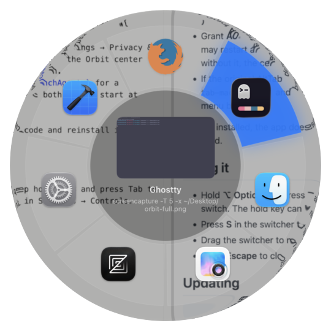

# AltTab, unlocked fork

A personal fork of [AltTab](https://github.com/lwouis/alt-tab-macos), the macOS window switcher, with every feature unlocked and a few changes of my own.

**This is not the official AltTab.** It's unaffiliated with the original project, I don't ship builds, and you build it yourself from source. For the real thing, go to [alt-tab.app](https://alt-tab.app/).

## Credit

AltTab is created and maintained by **[Louis Pontoise (lwouis)](https://github.com/lwouis)** together with [many contributors](docs/contributors.md). Nearly all of the code here is theirs: the window tracking, thumbnails, keyboard handling, settings and everything else that makes AltTab work. This fork changes a small part of it.

If you find AltTab useful, please support the original project at [alt-tab.app](https://alt-tab.app/) and [github.com/lwouis/alt-tab-macos](https://github.com/lwouis/alt-tab-macos). See also the [acknowledgments](docs/acknowledgments.md) for the libraries AltTab builds on.

## What's different from the original

<p align="center"></p>

- **Everything unlocked.** Search, extra shortcuts, the App Icons and Titles styles and auto-size all work, with no trial, license or upgrade screens.
- **Orbit style, the new default.** The switcher is a round panel: one ring segment per open window, each showing its app icon, around a center that previews the selected window with its app name and title. Segments share the ring equally (2 windows take half each), and extra rings appear when one gets crowded. The selected segment lights up in your accent color. Left/right go around the ring; up/down move between rings. Searching switches to the Titles list, and the ring shrinks into the center and fans back out when you leave search. Pick another style any time in Settings → Appearance.
- **Custom app icons look right.** AltTab trims a fixed border off app icons to fit Apple's icon grid, which used to cut into icons you replaced yourself in Finder. It now never trims past an icon's actual empty border.
- **No updates.** The updater is removed, so the app never checks for, offers or installs the official build over yours.
- **Spotlight-style search bar** in the switcher.
- **Draggable switcher.** Drag it anywhere with the mouse; it remembers the spot.
- **Spotlight or AltTab, never both.** Pressing ⌘-Space while the switcher is open closes the switcher and opens Spotlight; opening the switcher while Spotlight is up closes Spotlight.
- **Escape always closes the switcher** in one press, including in search mode.
- **App icon** uses AltTab's original colorful logo.

## Requirements

- macOS 12 or later
- [Xcode](https://apps.apple.com/app/xcode/id497799835) (free from the App Store)
- No Apple developer account needed

## Setup

All commands run in Terminal.

**1. Get the code**

```sh
git clone https://github.com/chiragJoshi24/alt-tab-macos.git
cd alt-tab-macos
```

**2. Set up Xcode's command-line tools** (asks for your Mac password)

```sh
sudo xcode-select -s /Applications/Xcode.app
sudo xcodebuild -runFirstLaunch
```

**3. Create a local signing certificate**

macOS ties AltTab's permissions to the certificate the app is signed with. A local self-signed certificate keeps them from resetting on every rebuild.

```sh
PATH=/usr/bin:$PATH scripts/codesign/setup_local.sh
```

The `PATH=/usr/bin:$PATH` part makes the script use macOS's built-in `openssl`. Homebrew's OpenSSL can produce a certificate file that macOS refuses to import. macOS asks for your password once, to trust the certificate.

Check it worked. This should list **"Local Self-Signed"**:

```sh
security find-identity -p codesigning
```

The certificate now lives in your keychain. Delete the loose copies the script left in the folder, since they include the unencrypted private key:

```sh
rm codesign.conf codesign.crt codesign.key codesign.p12
```

**4. Create the local build settings**

This file is git-ignored. It sets the version number (the app crashes at launch without it) and signs the release build with your local certificate instead of the original author's.

```sh
cat > config/local.xcconfig <<'EOF'
CURRENT_PROJECT_VERSION = 11.10.1
CODE_SIGN_IDENTITY = Local Self-Signed
OTHER_CODE_SIGN_FLAGS = --timestamp=none --deep --options runtime
EOF
```

**5. Build**

```sh
xcodebuild -project alt-tab-macos.xcodeproj -scheme Release -configuration Release -derivedDataPath DerivedData build
```

This is the optimized build, the one to use day to day. The first build takes a few minutes. (`bash ai/build.sh` makes a developer build instead: slower, and it opens a floating "QA Menu" testing panel on every launch.)

**6. Install**

Quit the official AltTab if it's installed, then:

```sh
rm -rf /Applications/AltTab.app
cp -R DerivedData/Build/Products/Release/AltTab.app /Applications/
open /Applications/AltTab.app
```

**7. First launch**

- Grant **Accessibility** and **Screen Recording** when asked (System Settings → Privacy & Security). AltTab may restart afterwards. Screen Recording is what lets the Orbit center preview the selected window; without it, the center shows the app icon.
- If the original AltTab was installed before, check `~/Library/LaunchAgents` for a leftover `com.lwouis.alt-tab-macos.plist` and delete it. Otherwise both copies start at login, and two AltTab icons show up in the menu bar.

Once installed, the app doesn't need Xcode. You can uninstall Xcode and reinstall it only when you want to rebuild.

## Using it

- Hold **⌥ Option** and press **Tab** to open the switcher; keep holding ⌥ and press Tab to move along; let go to switch. The hold key can be changed to ⌘ in Settings → Controls.
- Press **S** in the switcher to search.
- Drag the switcher to move it.
- Press **Escape** to close it.

## Updating

```sh
git pull
xcodebuild -project alt-tab-macos.xcodeproj -scheme Release -configuration Release -derivedDataPath DerivedData build
```

Then quit AltTab and repeat step 6. Your permissions carry over, because the signing certificate stays the same.

## License

AltTab is licensed under the [GNU General Public License v3.0](LICENCE.md), and so is this fork. You're free to use, modify and share it under the same terms.
